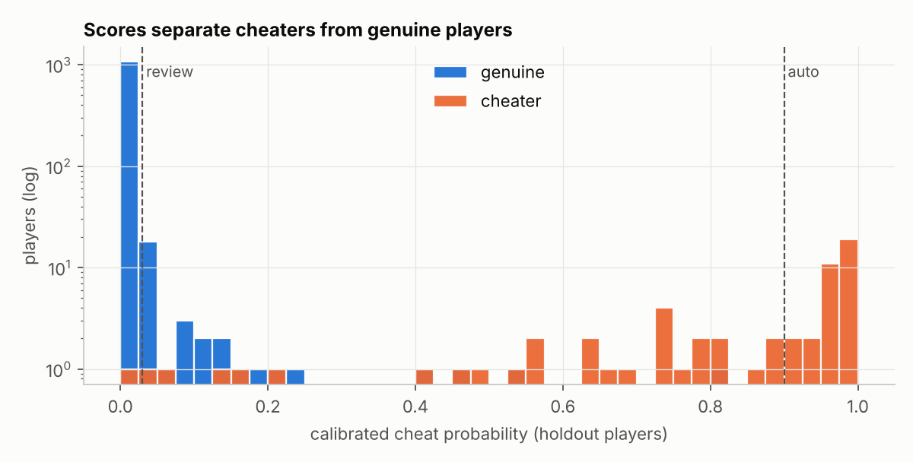

# BGMI-Inspired Match Integrity & Matchmaking Health Pipeline

An end-to-end **data engineering + data science** project that simulates a battle-royale game's telemetry and analyses player activity, suspicious gameplay, match health, and matchmaking trade-offs.

The project is designed around three operational questions:

1. **Player activity:** Who is playing, how often, and how concentrated is match activity?
2. **Match integrity:** How can suspicious behaviour be detected without automatically punishing genuine high-skill players?
3. **Matchmaking health:** Where do queue delays, network incidents, telemetry gaps, and lobby-quality problems occur?

> **Important data disclaimer:** BGMI's production telemetry is not public. This project uses synthetic/simulated data and is not based on KRAFTON/BGMI internal data. It is an independent portfolio project, not an official BGMI anti-cheat system.

---

## Project at a glance

| Item | Details |
|---|---|
| Project type | Data Engineering + Data Science |
| Language | Python |
| Data volume | 497,488 simulated player-match rows |
| Simulated population | 4,000 players |
| Planned match/lobby count | 5,000 |
| Lobby size | 100 players |
| Storage | SQLite |
| Analytics | SQL, Pandas, NumPy |
| Machine learning | Scikit-learn |
| Visualisation | Matplotlib |
| Testing | Pytest |
| Pipeline entry point | `run_pipeline.py` |

## Key results

- Validated **497,488** simulated player-match rows.
- Retained **494,266** clean rows and quarantined **3,222** invalid rows.
- Evaluated the detection model on a held-out set of **1,165 eligible players**, including **62 simulated cheaters**.
- Recorded **zero genuine players automatically actioned** under the conservative auto-action policy in this holdout.
- Detected an injected regional disconnect spike and an injected telemetry-volume drop.
- Compared fixed and progressive matchmaking windows; the progressive strategy reduced simulated average queue time from **41.7 s to 20.7 s at peak** and from **139.9 s to 49.1 s off-peak**.

These are results on synthetic data. They demonstrate the pipeline and its evaluation design; they are not claims about real BGMI players or production game performance.

---

## Table of contents

- [Architecture](#architecture)
- [Technology stack](#technology-stack)
- [1. Player activity analytics](#1-player-activity-analytics)
- [2. Safety-first suspicious-player detection](#2-safety-first-suspicious-player-detection)
- [3. Matchmaking and match-health monitoring](#3-matchmaking-and-match-health-monitoring)
- [4. Matchmaker simulation](#4-matchmaker-simulation)
- [5. Data quality and ingestion](#5-data-quality-and-ingestion)
- [Project structure](#project-structure)
- [Setup and installation](#setup-and-installation)
- [Run the pipeline](#run-the-pipeline)
- [Run the tests](#run-the-tests)
- [Outputs](#outputs)
- [Limitations and responsible interpretation](#limitations-and-responsible-interpretation)
- [Possible next improvements](#possible-next-improvements)
- [Resume highlights](#resume-highlights)

## Architecture

```text
                         run_pipeline.py
                                |
                                v
                         simulate.py
                  Synthetic game telemetry
                                |
                                v
                           ingest.py
              Validation, cleaning, quarantine
                                |
                                v
                       SQLite warehouse
                       (sql/schema.sql)
                                |
                 +--------------+--------------+
                 |                             |
                 v                             v
           features.py                   match_health.py
        SQL + player stats             SQL + health alerts
                 |                             |
                 v                             |
              detect.py                        |
       Model + safety policy                   |
                 |                             |
                 +--------------+--------------+
                                |
                                v
                        matchmaker_sim.py
                       Queue simulation
                                |
                                v
                            report.py
                                |
                                v
                            outputs/
                    JSON + CSV + PNG charts
```

The pipeline is run from the repository root:

```bash
python run_pipeline.py
```

The default run takes approximately **30–60 seconds**, depending on the machine.

## Technology stack

| Area | Tools |
|---|---|
| Programming | Python |
| Data manipulation | Pandas, NumPy |
| Machine learning | Scikit-learn |
| Database | SQLite |
| Querying | SQL |
| Visualisation | Matplotlib |
| Testing | Pytest |
| Version control | Git, GitHub |

---

## 1. Player activity analytics

The activity analysis uses SQL window functions and aggregation, including CTEs, `NTILE`, and `RANK`, to understand how match activity is distributed across players.

### Findings from the simulated dataset

| Metric | Result |
|---|---:|
| Players represented in activity output | 3,991 |
| Median matches per player | 88 |
| Mean matches per player | 123.8 |
| Maximum matches by one player | 1,143 |
| Share of matches generated by the most-active 10% | 33.0% |
| Share of matches generated by the least-active 30% | 6.8% |

The activity distribution is strongly uneven. This matters for detection: players with very few matches should not be treated as suspicious simply because a small sample produces an extreme-looking statistic.


---

## 2. Safety-first suspicious-player detection

The detection component combines statistical evidence with a calibrated gradient-boosting classifier. The model estimates a suspicious-player probability, while a separate policy determines whether the result should be cleared, monitored, reviewed by a human, or considered for automatic action.

### Evidence signals

The simulated feature set includes:

- Headshot share.
- Shooting accuracy.
- Ping-adjusted reaction time.
- Kills without line of sight.
- Movement-speed anomalies on a clean network.
- Repeated suspicious matches over time.

Network conditions are considered before using movement-speed evidence. This helps avoid treating lag-related behaviour as proof of cheating.

### Decision policy

| Tier | Meaning |
|---|---|
| `INSUFFICIENT_DATA` | Fewer than 8 matches; collect more evidence and do not take action. |
| `CLEAR` | Available evidence does not cross the monitoring threshold. |
| `WATCHLIST` | Low-level signal that may warrant continued monitoring. |
| `HUMAN_REVIEW` | Suspicious score is high enough for a person to investigate. |
| `AUTO_ACTION` | Requires probability of at least 0.90, at least 2 independent evidence channels, and at least 4 suspicious matches. |

**A model probability by itself does not trigger automatic action.** The policy uses minimum sample size, persistence, and independent evidence requirements.

### Holdout evaluation

The saved evaluation uses 1,165 eligible players, including 62 simulated cheaters.

| Metric | Result |
|---|---:|
| ROC-AUC | 0.9981 |
| PR-AUC | 0.9726 |
| Players in automatic-action tier | 15 |
| Genuine players automatically actioned | 0 |
| Automatic-action precision | 100% |
| Automatic-action recall | 24.19% |
| Combined recall: automatic action + human review | 98.39% |
| Human-review queue | 76 |

The automatic-action tier is intentionally conservative: it catches a smaller portion of simulated cheaters while avoiding automatic action against genuine players in this holdout. Less certain cases are routed to human review.

### Baseline comparison

| Method | Flagged | Genuine-player false positives | Precision | Recall |
|---|---:|---:|---:|---:|
| Naive high K/D rule | 57 | 46 | 19.30% | 17.74% |
| Isolation Forest baseline | 52 | 15 | 71.15% | 59.68% |
| Proposed automatic-action tier | 15 | 0 | 100% | 24.19% |

A notable synthetic edge case is the smurf group: the naive K/D rule flagged 37 of 38 genuine smurf players, while the proposed automatic-action tier actioned none of them.




### Quarantine trade-off

The project also compares two simulated quarantine choices:

| Policy | Cheaters isolated | Genuine players included in quarantine | Matches containing a cheater after policy |
|---|---:|---:|---:|
| Automatic-action tier only | 19.0% | 0 | 99.7% |
| Automatic action + review tier | 94.8% | 113 | 6.9% |

Quarantining the review tier improves simulated isolation but also includes genuine players who have not been confirmed as cheaters. This is a product and fairness trade-off, not merely a model-tuning decision.

---

## 3. Matchmaking and match-health monitoring

The monitoring pipeline analyses match-level and regional indicators, including:

- Queue duration.
- Disconnect rate.
- Ping.
- Bot participation.
- Lobby rating spread.
- Daily match volume.
- Regional anomalies.

### Injected incidents detected

| Incident | Detection result |
|---|---|
| Regional network incident | IN-South, 17 October 2026; disconnect rate reached 34.43% |
| Telemetry logging gap | IN-North, 9 October 2026; match-volume ratio dropped to 0.32 |

The health-monitoring code uses robust rolling statistics, including median and Median Absolute Deviation (MAD), to identify unusual changes.


---

## 4. Matchmaker simulation

The project compares two queue strategies:

- **Fixed window:** players are matched within a fixed ±150 MMR window.
- **Progressive window:** starts at ±100 MMR and widens by 6 MMR per second waited, up to ±500 MMR.

### Simulation results

| Scenario | Strategy | Average queue | P95 queue | Average bots per lobby | Unfair slots |
|---|---|---:|---:|---:|---:|
| Peak | Fixed | 41.7 s | 90 s | 40.9 | 0.0% |
| Peak | Progressive | 20.7 s | 55 s | 15.4 | 1.3% |
| Off-peak | Fixed | 139.9 s | 410 s | 69.6 | 0.0% |
| Off-peak | Progressive | 49.1 s | 110 s | 67.5 | 6.5% |

The progressive strategy reduces simulated waiting time, but wider MMR windows can increase lobby imbalance. The maximum window is therefore an important tuning parameter.


---

## 5. Data quality and ingestion

The ingestion step validates incoming simulated player-match records before loading accepted rows into the SQLite warehouse. Invalid records are written to a quarantine/rejected-rows table with a reason rather than being silently discarded.

### Data-quality results

| Metric | Rows |
|---|---:|
| Input rows | 497,488 |
| Clean rows | 494,266 |
| Rejected rows | 3,222 |
| Orphan rows | 0 |

### Rejection breakdown

| Reason | Rows |
|---|---:|
| Duplicate match-player record | 1,488 |
| Missing required field | 992 |
| Hits exceed shots fired | 494 |
| Negative value | 248 |
| **Total rejected** | **3,222** |

The validation checks include duplicate match-player keys, required-field nulls, impossible hit/shot counts, and negative values.

---

## Project structure

```text
bgmi-match-integrity/
│
├── outputs/
│   ├── charts/
│   │   ├── 01_activity.png
│   │   ├── 02_scores.png
│   │   ├── 03_false_positives.png
│   │   ├── 04_genuine_slices.png
│   │   ├── 05_disconnect_alert.png
│   │   ├── 06_queue_by_tier.png
│   │   └── 07_matchmaker_sim.png
│   ├── daily_health.csv
│   ├── detection_metrics.json
│   ├── dq_report.json
│   ├── match_health.json
│   ├── matches_per_player.csv
│   ├── matchmaker_comparison.csv
│   └── player_scores.csv
│
├── sql/
│   ├── lobby_health.sql
│   ├── matches_per_player.sql
│   ├── player_features.sql
│   └── schema.sql
│
├── src/
│   ├── __init__.py
│   ├── config.py
│   ├── db.py
│   ├── detect.py
│   ├── features.py
│   ├── ingest.py
│   ├── match_health.py
│   ├── matchmaker_sim.py
│   ├── report.py
│   ├── run_detection.py
│   └── simulate.py
│
├── tests/
│   ├── __init__.py
│   └── test_pipeline.py
│
├── .gitignore
├── README.md
├── requirements.txt
└── run_pipeline.py
```

**Runtime data note:** The pipeline creates a `data/` directory containing raw simulated data, evaluation ground truth, and the SQLite database. This directory is excluded from Git by `.gitignore`; generated reports and charts are stored in `outputs/`.

---

## Setup and installation

### Requirements

- Python 3.10 or newer recommended.
- Git.
- pip.

### 1. Clone the repository

```bash
git clone https://github.com/aggarwalharsh868-creator/bgmi-match-integrity.git
cd bgmi-match-integrity
```

### 2. Create a virtual environment

**macOS / Linux**

```bash
python3 -m venv .venv
source .venv/bin/activate
```

**Windows PowerShell**

```powershell
py -m venv .venv
.\.venv\Scripts\Activate.ps1
```

**Windows Command Prompt**

```cmd
py -m venv .venv
.venv\Scripts\activate.bat
```

### 3. Install dependencies

```bash
python -m pip install --upgrade pip
pip install -r requirements.txt
```

---

## Run the pipeline

Run the command from the repository root, with the virtual environment activated:

```bash
python run_pipeline.py
```

The script runs the following stages:

1. Generate synthetic telemetry.
2. Validate and ingest data into SQLite.
3. Build player features and run suspicious-player detection.
4. Analyse match health and regional alerts.
5. Compare matchmaking strategies.
6. Generate CSV, JSON, and chart outputs.

The default configuration is defined in `src/config.py`. The entry point also accepts optional player and match counts:

```bash
python run_pipeline.py --players 4000 --matches 5000
```

---

## Run the tests

Install the dependencies first, then run:

```bash
python -m pytest -q
```

The current test suite contains **7 tests** covering:

- Simulation shape and separation of evaluation labels from telemetry features.
- Data validation and rejected-row quarantine.
- SQLite warehouse creation and player feature generation.
- Small-sample statistical safeguards.
- Hard rules in the detection policy.
- Progressive matchmaking queue-time behaviour.
- Robust alert detection for a disconnect spike.

---

## Outputs

After a successful pipeline run, inspect:

| Output | Purpose |
|---|---|
| `outputs/daily_health.csv` | Daily regional health metrics |
| `outputs/detection_metrics.json` | Holdout model and policy metrics |
| `outputs/dq_report.json` | Ingestion and data-quality summary |
| `outputs/match_health.json` | Match-health metrics and detected incidents |
| `outputs/matches_per_player.csv` | Player activity summary |
| `outputs/matchmaker_comparison.csv` | Fixed vs progressive queue simulation |
| `outputs/player_scores.csv` | Player-level detection scores |
| `outputs/charts/` | Seven generated visualisations |

---

## Limitations and responsible interpretation

- All gameplay telemetry and player labels are simulated. No real BGMI/KRAFTON telemetry is used.
- The model's performance on synthetic data may be substantially better than performance on noisy real-world data.
- Simulated labels stand in for confirmed historical outcomes; real-world labels can be incomplete, delayed, or disputed.
- The matchmaker is a simplified simulation and does not represent a production matchmaking service.
- The human-review tier is not a confirmed cheating decision. It represents cases that require investigation.
- Automatic enforcement in a real game would require stronger validation, operational safeguards, appeals, and human oversight.

## Possible next improvements

- Add a Power BI dashboard for player activity, match health, and model monitoring.
- Introduce PostgreSQL as an alternative analytical warehouse.
- Add a streaming ingestion layer such as Kafka.
- Add experiment tracking and model-version comparisons.
- Add CI checks with GitHub Actions.
- Expand tests for edge cases, reproducibility, and data contracts.

---

## Resume highlights

**BGMI-Inspired Match Integrity & Matchmaking Health Pipeline**  
*Python, SQL, SQLite, Pandas, NumPy, Scikit-learn, Matplotlib, Pytest*

- Built an end-to-end data engineering and data science pipeline processing **497K simulated player-match records**, with validation and rejected-row quarantine.
- Developed a safety-first suspicious-player detection workflow combining statistical evidence, calibrated machine learning, minimum-sample rules, and tiered review decisions.
- Evaluated the policy on held-out synthetic data, recording **zero genuine players automatically actioned** in the evaluation set.
- Implemented SQL-based player analytics, regional match-health alerts, and a fixed-versus-progressive matchmaking simulation.

---

**Author:** Harsh Aggarwal  
**GitHub:** [aggarwalharsh868-creator](https://github.com/aggarwalharsh868-creator)  
**Repository:** [bgmi-match-integrity](https://github.com/aggarwalharsh868-creator/bgmi-match-integrity)
