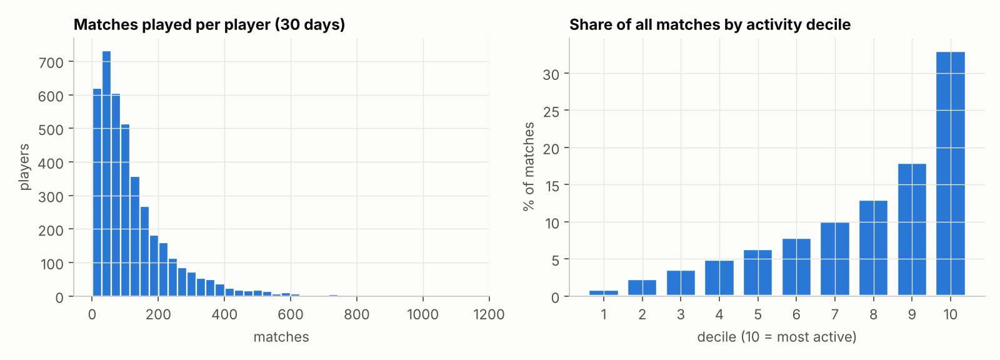
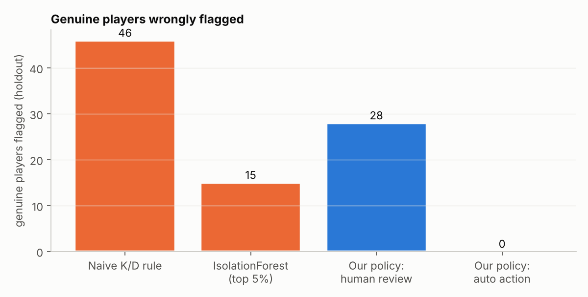
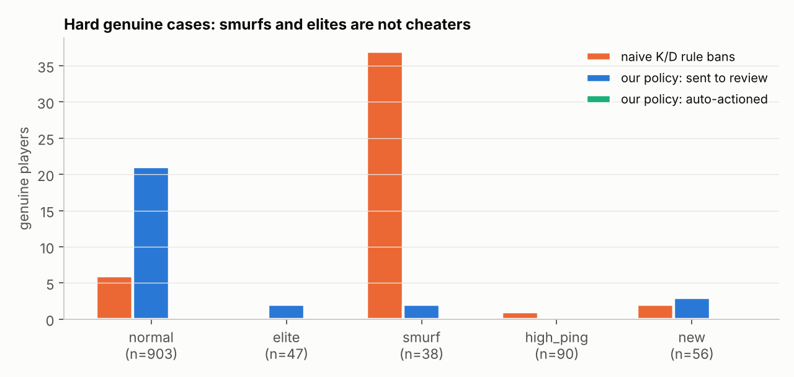
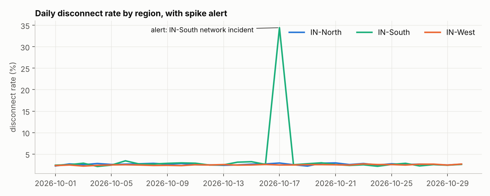
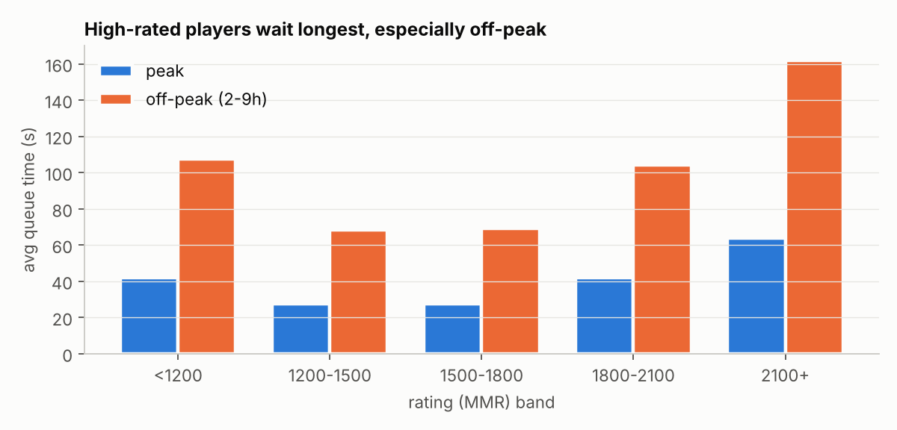
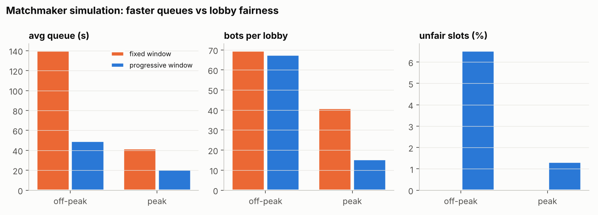

# Match Integrity & Matchmaking Health Pipeline (BGMI-inspired)

An end-to-end **data engineering + data science** project on a battle-royale game (modelled on BGMI).
It answers three questions a live-ops / game-data team actually asks:

1. **Who is playing how much?** (activity per player, matches per day, heavy-tail usage)
2. **Is someone cheating in matchmaking, and can we act without punishing genuine players?**
3. **What goes wrong in matchmaking and in matches, and how do we detect and fix it?**

> **Data note.** BGMI telemetry is not public, so the data is **simulated** (about 500k player-match rows,
> 4,000 players, 5,000 lobbies of 100) with realistic structure: heavy-tailed play frequency, rating-based
> lobbies, regional servers, intermittent cheaters and deliberately hard genuine cases. Ground truth is kept
> in a separate folder and used **only for evaluation**. This is not Krafton data and not their anti-cheat.

## Architecture

```
simulate.py ──► data/raw/*.csv  (messy on purpose: duplicates, nulls, impossible values, a logging gap)
                     │
              ingest.py (validate, quarantine bad rows)  ──► SQLite warehouse (sql/schema.sql)
                     │                                          players · matches · player_match_stats · rejected_rows
        ┌────────────┴─────────────┐
 features.py (SQL + stats)    match_health.py (SQL + alerts)
        │                          │
 detect.py (model + policy)   matchmaker_sim.py (queue simulation)
        └────────────┬─────────────┘
                 report.py ──► outputs/ (metrics JSON, CSVs, charts)
```

Run everything: `pip install -r requirements.txt && python run_pipeline.py` (about 20 s) · tests: `pytest`

## 1. How many matches is each player playing?
`sql/matches_per_player.sql` (CTE + `NTILE` + `RANK` window functions). Median player: 88 matches in 30 days,
mean 124, max 1,143. **The most active 10% of players generate 33% of all matches**, and the least active 30% only about 7%.
This activity profile is also why detection needs minimum-sample rules (below).



## 2. Cheat detection that does not punish genuine players
**Evidence, not vibes.** Per player we compute statistical evidence against the *human ceiling*
(headshot share, accuracy, ping-adjusted reaction time, kills through walls, speed on a clean network).
Binomial / normal z-scores mean a player with 5 matches cannot look "extreme" by luck, and a genuine elite player
(high but below the ceiling) scores negative. Cheaters only cheat in some matches, so we also count
*persistently suspicious matches*, since averages dilute them.

**Lag is not cheating.** Speed-hack evidence only counts matches on a clean network (ping < 80 ms, loss < 1%).

**Model + policy.** A calibrated gradient-boosting model gives a cheat probability, but **probability alone never
triggers action**. The policy has four tiers:

| Tier | Rule | Action |
|---|---|---|
| INSUFFICIENT_DATA | fewer than 8 matches | never act, keep collecting |
| WATCHLIST / CLEAR | low probability | monitor only |
| HUMAN_REVIEW | probability above a precision-based threshold | a human looks before anything happens |
| AUTO_ACTION | probability >= 0.90 **and** >= 2 independent evidence channels **and** >= 4 suspicious matches | automatic action |

Thresholds are chosen on development data (out-of-fold), then evaluated on a **held-out 30% of players**.

### Results (holdout: 1,165 eligible players, 62 cheaters)
| | Flagged | Genuine players wrongly flagged | Precision | Cheaters caught |
|---|---|---|---|---|
| Naive "K/D too high" rule | 57 | **46** | 19% | 18% |
| IsolationForest (top 5%) | 52 | 15 | 71% | 60% |
| **This policy: AUTO_ACTION** | 15 | **0** | **100%** | 24% |
| **This policy: AUTO + HUMAN_REVIEW** | 89 | 28 sent to *review*, 0 punished | 62% (review tier) | **98%** |

* The naive K/D rule would have banned **37 of 38 smurfs** (skilled players on new accounts). The policy auto-actioned none.
* Auto-action is deliberately conservative: it catches blatant cheaters (24%), and everything subtler goes to humans.
* ROC-AUC 0.998 / PR-AUC 0.972 on holdout. **These are optimistic**: simulated cheat signals are cleaner than real ones.
  Treat the *relative* comparison and the safety design as the finding, not the absolute AUC.




## 3. Problems in matchmaking and matches, and how the pipeline handles them
| Problem | How it is detected here | Mitigation |
|---|---|---|
| **Cheaters in lobbies** (avg 6.9 per match) | detection pipeline above | quarantine pool (see trade-off below) |
| **Long queues for top-rated players, worst off-peak** (162 s vs 64 s at 2100+ MMR) | queue time by rating band and hour (SQL) | progressive MMR window |
| **Bots filling lobbies** | `bot_count` per match, by period | wider windows, shorter waits |
| **Unfair / wide lobbies** | lobby MMR spread (`sql/lobby_health.sql`) | hard cap on window growth |
| **Server / network incident** | rolling robust z-score (median/MAD) on daily disconnect rate per region: **caught IN-South, 17 Oct (34% vs ~3%)** | alert, route players away |
| **Silent telemetry loss** | daily match volume vs trailing median: **caught IN-North, 9 Oct (ratio 0.32)** | pipeline alert before analytics go wrong |
| **Dirty data** | validation rules + `rejected_rows` quarantine: 3,222 of 497k rows rejected (duplicates, nulls, hits > shots, negatives) | never silently dropped |




### Matchmaker simulation (fixed vs progressive window)
Fixed +/-150 MMR vs a window that starts at +/-100 and widens 6 MMR per second waited (cap +/-500):

| Scenario | Strategy | Avg queue | P95 queue | Bots / lobby | Unfair slots (>400 MMR from lobby mean) |
|---|---|---|---|---|---|
| Peak | fixed | 41.7 s | 90 s | 40.9 | 0% |
| Peak | **progressive** | **20.7 s** | **55 s** | **15.4** | 1.3% |
| Off-peak | fixed | 139.9 s | 410 s | 69.6 | 0% |
| Off-peak | **progressive** | **49.1 s** | **110 s** | 67.5 | 6.5% |

Waiting halves or better and fewer bots at peak, **at the price of looser lobbies**. That trade-off is real; the
cap is the tuning knob. Absolute numbers depend on simulated arrival rates, so read the comparison, not the values.



### Cheater quarantine: an honest trade-off
Matching only flagged players with each other (out-of-sample flags):

| Quarantine who | Matches with a cheater | Cheaters isolated | Genuine players caught in it |
|---|---|---|---|
| Nobody | 99.9% | 0% | 0 |
| AUTO tier only | 99.7% | 18.5% | **0** |
| AUTO + REVIEW | **6.9%** | 94.8% | 111 of 311 |

Quarantining the review tier cleans lobbies dramatically but parks 111 genuine players with cheaters until a human
clears them. That is a product decision, not a modelling one, so the pipeline exposes both options.

## Honest limitations
* Simulated data: detection scores are optimistic, and real systems rely on client/server integrity checks and human review too.
* Training labels stand in for "confirmed past bans"; real labels are noisy and delayed.
* The matchmaker simulation is a single-region toy model (no parties, latency or role constraints).
* Intermittent, low-intensity cheaters are the hardest cases; the review tier exists for them.

## Project layout
```
src/            simulate · ingest · features · detect · match_health · matchmaker_sim · report
sql/            schema.sql · player_features.sql · matches_per_player.sql · lobby_health.sql
tests/          7 tests: no label leakage, data validation, small-sample safety, policy hard rules, alerts, matchmaker
outputs/        detection_metrics.json · match_health.json · dq_report.json · charts/*.png · CSVs
run_pipeline.py end-to-end entry point
```

## Resume bullets (edit to taste)
* Built a BGMI-inspired match-integrity pipeline (Python, SQL/SQLite, pandas, scikit-learn) processing ~500k simulated player-match records with automated data-quality validation and a rejected-rows quarantine.
* Designed a safety-first cheat-detection policy (statistical evidence + calibrated gradient boosting + tiered actions): **0 genuine players auto-actioned** on holdout while a naive K/D rule wrongly flagged 46 (37 of 38 smurfs).
* Built match-health monitoring (robust z-score alerts) that detected a regional network incident and a silent telemetry loss, and a matchmaker simulation showing a progressive MMR window cut peak queue time by ~50% and bots per lobby from 41 to 15.
